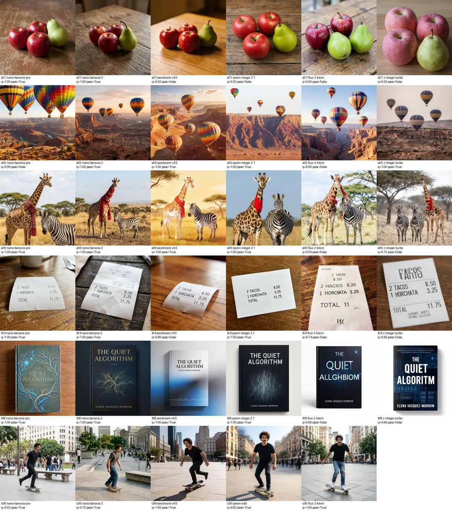

# gen-eval

An eval harness for generative image and video models. It runs a **versioned set of prompts**
through several models on the [Magic Hour API](https://magichour.ai), scores every output
automatically, and ranks the models by **credits per acceptable output**, which is what a buyer
actually pays to get one usable render, retries included.

It scores three things:

| What | How | Scorer |
|---|---|---|
| **Character consistency** (same person across scenes and through a video) | YuNet face detection + SFace embeddings, cosine similarity to a reference face; worst frame for video | `scorers/face.py` |
| **Text legibility** (signs, posters, receipts, thumbnails) | RapidOCR (PP-OCR, ONNX), approximate substring edit distance per required string, plus a count of invented non-words | `scorers/ocr.py` |
| **Prompt adherence** (counts, colors, positions, style) | v1: CLIP ViT-L/14 with contrastive foils. v2: open-vocabulary detector (YOLOE) fact checks. CLIP failed calibration (see below) | `scorers/clip.py`, `scorers/checks.py` |

Each scorer is checked against hand labels before its numbers are trusted, and two of them were
changed because of what that check found.



## Results (eval set v2, 164 scored renders)

All numbers come from real renders. **8,795 credits** in total: 20 for the four reference faces,
1,395 for the probe run, 6,960 for the main run and 420 for the held-out adherence check. The v2
scores reuse the v1 renders (see [Versioning](#versioning)), so moving to v2 cost nothing extra.

"Scorer pass" is the automatic verdict. "Labeled pass" is a human yes/no on every output: *would
you ship this without regenerating?* Credits per labeled pass = credits per render / labeled pass
rate.

**Text in images** (8 prompts)

| Model | Credits/render | Scorer pass | Labeled pass | Credits per labeled pass |
|---|---:|---:|---:|---:|
| qwen-image-2.1 | 10 | 88% | 100% | **10** |
| z-image-turbo | 5 | 62% | 62% | 8 |
| seedream-v4.5 | 50 | 75% | 100% | 50 |
| nano-banana-2 | 50 | 88% | 75% | 67 |
| nano-banana-pro | 150 | 88% | 100% | 150 |
| flux-2-klein | 5 | 12% | 0% | never |

**Prompt adherence** (14 prompts for the four cheaper models, 8 for seedream and pro)

| Model | Credits/render | Scorer pass | Labeled pass | Credits per labeled pass |
|---|---:|---:|---:|---:|
| flux-2-klein | 5 | 57% | 79% | 6 |
| z-image-turbo | 5 | 57% | 64% | 8 |
| qwen-image-2.1 | 10 | 79% | 93% | **11** |
| nano-banana-2 | 50 | 79% | 100% | 50 |
| seedream-v4.5 | 50 | 62% | 88% | 57 |
| nano-banana-pro | 150 | 75% | 100% | 150 |

**Character consistency** (7 prompts, reference photo plus an edit model)

| Model | Credits/render | Scorer pass | Labeled pass | Credits per labeled pass |
|---|---:|---:|---:|---:|
| flux-2-klein | 5 | 86% | 100% | **5** |
| qwen-edit | 10 | 71% | 100% | 10 |
| seedream-v4.5 | 50 | 100% | 100% | 50 |
| nano-banana-2 | 50 | 86% | 86% | 58 |
| nano-banana-pro | 150 | 100% | 86% | 175 |

**Image to video** (3 clips, 5 s, from a reference headshot)

| Model | Credits/clip | Scorer pass | Labeled pass |
|---|---:|---:|---:|
| ltx-2.5 @480p | 120 | 100% | 100% |
| seedance-2.0-mini @480p | 240 | 100% | 100% |
| kling-3.0 @720p | 300 | 100% | 100% |

What this says, with the caveat that 7 to 14 prompts per suite gives wide intervals (the
leaderboard JSON has bootstrap 95% CIs over items):

- **The cheapest model is not the cheapest per usable output.** flux-2-klein costs 5 credits and
  never got a text prompt right ("MORNNG BREW CAFE", "THE QUIET ALLGHBIOM"). For text,
  qwen-image-2.1 at 10 credits matched nano-banana-pro's labeled pass rate at 1/15 of the price.
- **nano-banana-2 invents text.** It spelled every requested string correctly but added garbled
  fake menus and receipt headers around them, which is why its labeled text pass is 75%.
- **Premium is worth it for adherence, not for identity.** nano-banana-2 and pro were the only
  models with no adherence failures. For keeping a person's identity, flux-2-klein (5 credits) and
  qwen-edit (10) were as good as anything in this set; pro lost the identity on the one wide shot
  (c06, small face).
- **The video suite is too easy.** All nine clips were acceptable, so it currently ranks on price
  alone (ltx-2.5). It needs harder motions and longer clips before it can separate models.
- **List price is not the price.** gpt-image-2 lists "from 50 credits" and was charged 100 at 1k,
  which is why the leaderboard always uses `credits_charged` from the API.

## Do the scorers agree with people?

`python -m geneval.cli calibrate RUN` compares every scorer with the hand labels:

| Suite | n | Labeled pass (base rate) | Scorer accuracy | AUC | P@1 best-of-N | Model-rank Spearman |
|---|---:|---:|---:|---:|---:|---:|
| Text (OCR, q2 rule) | 48 | 73% | 0.88 | 0.88 | 0.75 | 0.74 |
| Character (SFace) | 35 | 94% | 0.83 | 0.82 | 1.00 | -0.30 |
| Adherence, CLIP contrastive (v1) | 48 | 83% | 0.58 | **0.42** | | |
| Adherence, detector checks (v2) | 72 | 86% | 0.71 | 0.67 | 1.00 | 0.85 |
| Video | 9 | 100% | 1.00 | | | |

How the scorers changed because of this:

1. **Contrastive CLIP could not judge adherence.** Each adherence prompt has foils that break one
   fact ("three red apples and one green pear" vs "two red apples and one green pear"). CLIP
   preferred the true prompt no more often than chance: AUC 0.42, and it caught 2 of 8 real
   failures. It sees a bag of words, so counts and color bindings are invisible to it. v2 replaces
   it with GenEval-style checks: YOLOE finds the objects, counts use a per-class relative
   threshold, colors come from the segmentation mask in HSV, positions from box centers. On the
   eight development prompts AUC went to 0.67 and it caught 5 of 8 failures (two apples, two
   zebras, one red umbrella instead of two). On **six held-out prompts written and committed
   before their renders existed** it scored AUC 0.64 vs CLIP's 0.52. Most remaining errors are
   false alarms: the detector misses small or stylized objects (a watercolor fox, a scarf) or names
   a shaded yellow taxi "orange". So the adherence scorer is useful for ranking (Spearman 0.85 with
   the labeled model ranking) but not yet for auto-rejecting single renders.
2. **OCR read receipts out of order and missed thumbnail fonts.** Reading every text render by eye
   showed three bugs: right-column prices on angled receipts were read on the wrong line, heavy
   slanted fonts were not detected on the color image, and O/0 confusion cost exact matches. Fixes:
   row clustering by vertical overlap with a tilted-pair fallback, reading the grayscale and
   inverted images too, and folding confusable glyphs. The first pass rule (90% character accuracy)
   also passed "MORNNG BREW CAFE" and garbled fake menus, so q2 requires 95% per string and at most
   one invented non-word. Agreement went from 0.78 to 0.88. That threshold was picked on the same
   48 labels, so treat 0.88 as in-sample.
3. **SFace is reliable on faces that fill the frame and noisy on small ones.** Its errors are on
   wide shots and on profile frames mid-turn in video; the model-rank correlation is negative only
   because nearly every edit model kept the identity, so there was little to rank.

The Precision@k numbers are the ranker view of the same question: per prompt, sort that prompt's
outputs (one per model) by the automatic score and check whether the top pick is acceptable.
Best-of-N selection by the harness picked an acceptable output 100% of the time for adherence and
character (base rates 86% and 94%) and 75% for text (base 73%; many text outputs tie at a perfect
score, so the pick among ties is arbitrary). Pooled Precision@5 is 1.00 in every suite: the five
outputs the harness rates highest are always ones a person would ship.

The labels are one reviewer's judgement (`evalsets/*/labels/reviewer-1.jsonl`, with notes on every
rejection). `GET /label?runs=...` serves a blind labeling page (model names and scores hidden,
shuffled order, `y` / `n` keys) so more reviewers can be added, and `calibrate --labeler` scores
each one.

## Versioning

An eval set is a directory: `evalsets/v2/suites.yaml` plus reference images. `freeze` writes
`MANIFEST.json` with a SHA-256 per item (its canonical JSON plus the bytes of any reference image).
`load` recomputes the hashes and refuses to run a published version that was edited: change it by
making a new version.

Every item also has a `render_key`, a hash of **only what the model sees** (endpoint, prompt,
aspect, duration, reference bytes). v2 added detector checks and six new prompts; the 26 items it
shares with v1 keep their render keys, so `plan --evalset v2 --reuse 1,2` re-scored 140 existing
renders for zero credits. Changing how something is scored never forces a re-render.

## Running it

```bash
docker compose up -d postgres redis
pip install -r requirements-checks.txt     # or requirements.txt without the detector checks
scripts/fetch_weights.sh                   # CLIP ViT-L/14 ONNX, YuNet, SFace, YOLOE
export MAGIC_HOUR_API_KEY=...
python -m geneval.cli migrate
python -m geneval.cli plan --name nightly --evalset v2 --budget 3000 --models nano-banana-2,qwen-image-2.1
python -m geneval.cli run 1 --local        # or without --local: enqueue on RQ and run `rq worker render`
python -m geneval.cli leaderboard 1 --json results/leaderboard.json
python -m geneval.cli calibrate 1
python -m geneval.cli export-router 1 --out router_labels.jsonl
uvicorn geneval.api:app                    # REST API + /label page
```

`docker compose up` runs the API, four render workers (I/O bound: submit, poll, download) and one
score worker (`SimpleWorker`, so CLIP, OCR and the face models load once instead of per job).

### How a run works

- `plan` writes one `generations` row per (item, model, sample). The unique key makes runs
  resumable.
- A render job reserves credits against the run's budget with an atomic Lua script in Redis
  (`spent + held + amount <= budget`), submits to Magic Hour, and **commits the project id before
  polling**, so a crash or failed download never loses a render that was already paid for. A row
  with a project id is re-polled, never re-submitted. On completion the reservation is settled to
  the `credits_charged` the API reports, and later reservations for that model use the highest
  price seen (the first gpt-image-2 render reserved 50 and was charged 100).
- A score job loads the output (8 evenly spaced frames for video, skipping frame 0, which
  image-to-video models return as the input image), runs the item's scorers, and stores each
  scorer's metrics under its own version, so a scorer change only re-scores.
- `leaderboard` takes the newest result per (item, model), bootstraps pass-rate CIs by resampling
  items (item difficulty is the main source of variance), and marks the cost/quality Pareto front.

## Model-router export

[model-router](https://github.com/RyGuy108/model-router) picks the cheapest Magic Hour model likely
to pass a quality bar, and was trained on simulated quality labels because nothing measured real
ones. `export-router` writes this harness's results in the router's training format: one row per
prompt with `req` and per-model `outcomes` of `{q, draft, standard, premium}` pass bits (see
`quality.bars`), plus `source: "gen-eval v2"` so real rows can be held out or weighted. By default it
keeps only models in the router's catalog; the v2 export (`results/router_labels_v2.jsonl`, 32
prompts, 76 model outcomes) loads directly into the router's `train.targets()`. 32 prompts is far too
few to train on alone. It is a validation set for the simulator, and the start of a real one.

## Layout

```
evalsets/v1, v2      prompts, references, frozen manifests, hand labels
geneval/evalset.py   loading, hashing, freezing, render keys
geneval/providers/   Magic Hour client (create, persist id, poll, download)
geneval/scorers/     face.py, ocr.py, clip.py (+ clip_tokenizer.py), checks.py
geneval/runner.py    plan / render / score, Redis budget, RQ jobs
geneval/quality.py   per-suite quality score, pass bar and router bars
geneval/rank.py      leaderboard, bootstrap CIs, Pareto front, head-to-head
geneval/calibrate.py agreement with labels, AUC, P@k, model-rank correlation
geneval/export.py    model-router training rows
geneval/api.py       FastAPI + blind labeling page
migrations/          Postgres schema
results/             v2 leaderboard, calibration and router labels
```

## Limitations

- 7 to 14 prompts per suite and one render per (prompt, model): enough to show the method and the
  big gaps (flux-2-klein on text), not to separate models that are close.
- One labeler. The thresholds for the text rule were chosen on those same labels.
- The adherence checks miss small and stylized objects, and named colors are fuzzy at hue
  boundaries; treat a single failed check as "look at this", not "reject".
- Reference characters are synthetic (generated with z-image-turbo), not real people.
